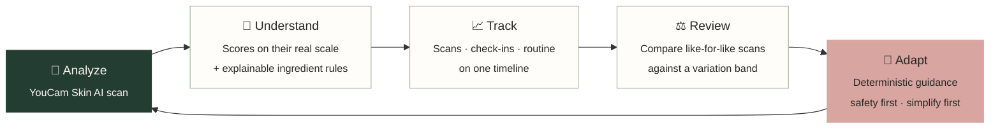
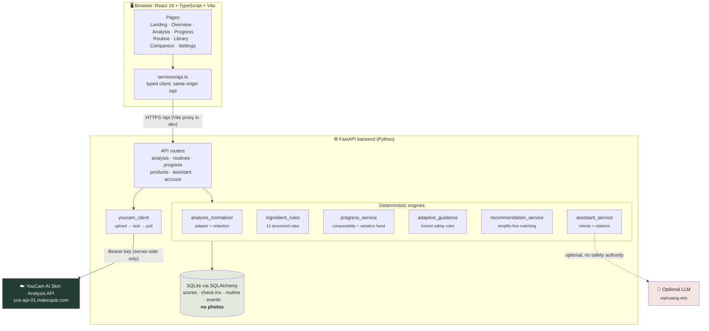
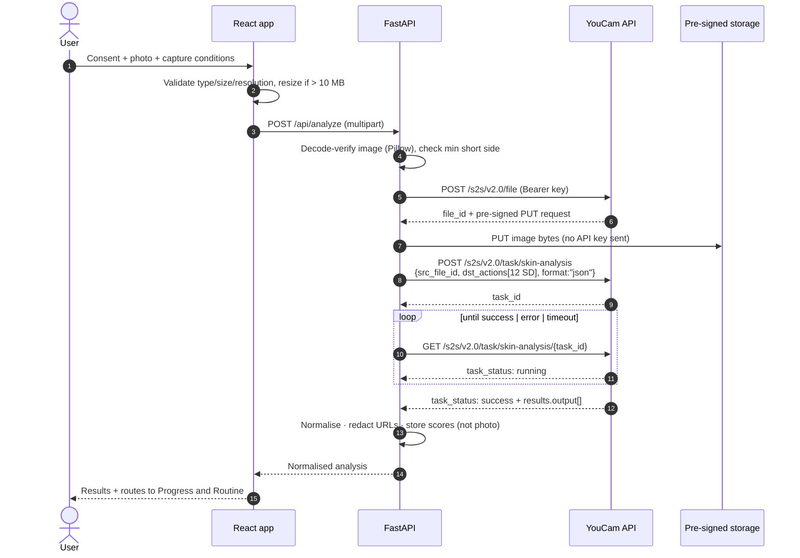
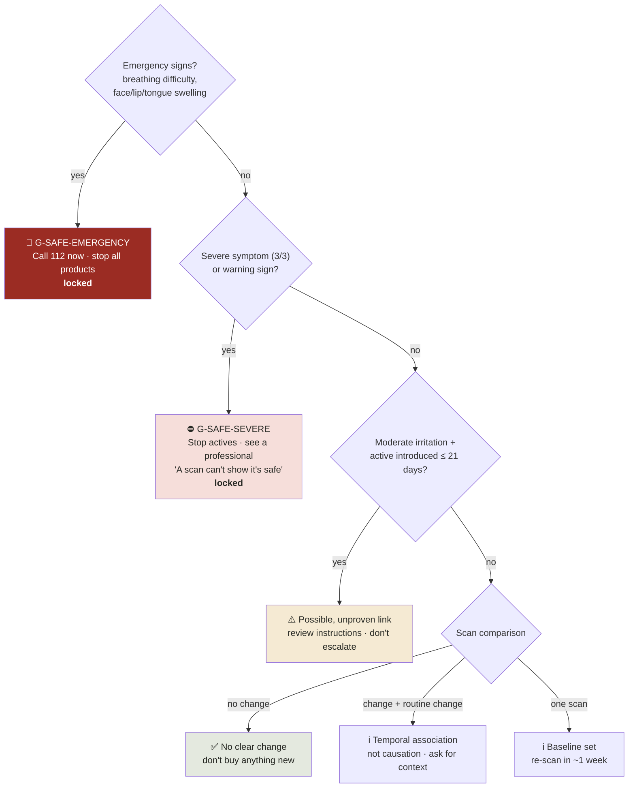

<div align="center">


# DermaTrack & Adapt

### Your skin evolves. Your routine should too.

**An AI-assisted skin intelligence platform that connects YouCam Skin AI scans, your skincare routine and your daily check-ins, so you can tell real change from normal variation.**

[](https://docs.perfectcorp.com/reference/ai_skin_analysis)
[](https://fastapi.tiangolo.com/)
[](https://react.dev/)
[](#-testing)

[Features](#-features) · [Screenshots](#-screenshots) · [Architecture](#-architecture) · [YouCam integration](#-youcam-skin-ai-integration) · [Engines](#-the-intelligence-engines) · [Quick start](#-quick-start) · [API](#-api-reference)

*Built for the **YouCam API Skin AI & eCommerce VTO Hackathon 2026** (Perfect Corp. × Devpost)*

</div>

---


## 🧭 The problem

People spend money on skincare without knowing whether their routine suits them. They layer active ingredients without understanding irritation risk, judge progress from single scans, and struggle to tell genuine change from day-to-day noise in lighting, angle and camera.

Most tools stop at **a score** or **a product suggestion**. They don't remember what you changed, when your skin reacted, or that last week's photo was taken in different light.

## 💡 The solution: one feedback loop



Every feature feeds the next step of the loop. Nothing in the app exists on its own.

---

## ✨ Features

| | Feature | What makes it different |
|---|---|---|
| 🔬 | **Skin Analysis Studio** | Consent → upload/selfie → preview → capture conditions → real YouCam analysis → results. Validates format, size and resolution in the browser *and* on the server. Large photos are resized in the browser. **The photo is never stored.** |
| 📈 | **My Progress** | Interactive trend chart with a ±3-point variation band and routine changes annotated as markers. 7/14/30-day and all-time windows, compare any two scans, a unified timeline, and a summary of *what changed and what's still uncertain*. |
| 🧴 | **My Routine** | AM/PM routines, actives with optional concentrations, frequency, start dates, instructions, pause/resume and reaction logging. Every edit is logged to the timeline. **Live compatibility preview** while you type. |
| 🧪 | **Ingredient Intelligence Engine** | 12 structured rules with ids, severities, explanations, sources, next steps and known limitations. Synonym-aware, frequency-aware and honest about what it couldn't evaluate. |
| 🛡️ | **Adaptive Guidance Engine** | Deterministic cards linking symptoms, routine timing and scan changes. **Safety rules are locked:** a reassuring scan can never override a severe reaction. |
| 💬 | **AI Skin Companion** | Answers questions from *your* records with **citations**, keeping "measured by AI" separate from "reported by you". It refuses to diagnose. It's rule-based by default and can optionally be rephrased by an LLM. |
| 🛍️ | **Explainable product matching** | Every match shows its reasons, the checks it passed or failed, and what information is missing. **Simplify-first:** when your routine has open issues, it recommends *nothing new*. |
| 🔐 | **Privacy & control** | Versioned consent, a JSON data export, one-click deletion, server-only keys and redacted provider logs. |
| 🧪 | **Labelled demo mode** | A one-click sample dataset with a deliberately mixed story, labelled on every screen and removable without touching real data. |

---

## 📸 Screenshots

<table>
<tr>
<td width="50%"><p align="center"><b>Overview:</b> latest scan, trend, alerts, routine and check-in due date</p></td>
<td width="50%"><p align="center"><b>My Progress:</b> variation band, routine markers, timeline and check-in</p></td>
</tr>
<tr>
<td><p align="center"><b>Scan results:</b> raw vs display score toggle, provenance badge</p></td>
<td><p align="center"><b>Live check:</b> adapalene flagged against existing actives <i>before</i> saving</p></td>
</tr>
<tr>
<td><p align="center"><b>Explainable rules:</b> severity, source, limitations, rule id</p></td>
<td><p align="center"><b>Companion:</b> grounded answers with record citations</p></td>
</tr>
<tr>
<td><p align="center"><b>Product Library:</b> "Before buying anything: simplify."</p></td>
<td><p align="center"><b>Locked safety rule:</b> severe reactions always come first</p></td>
</tr>
</table>

<p align="center">

&nbsp;&nbsp;&nbsp;

</p>
<p align="center"><i>Fully responsive, with a bottom tab bar on mobile</i></p>

> Screenshots use the labelled demonstration dataset and the development fixture. They are not real measurements of anyone's skin.

---

## 🏗️ Architecture



### Design principles

1. **Never fabricate.** No invented scores, history, prices, concentrations, testimonials or clinical claims. Missing data is reported as missing.
2. **Deterministic where it matters.** Safety and compatibility decisions come from inspectable rules, never from a language model.
3. **Provenance everywhere.** Every scan carries a `source` badge (`YouCam Skin AI` / `Development fixture` / `Demonstration sample`) and data classes are never mixed in comparisons.
4. **Correlation ≠ causation.** Routine changes are shown as *temporal associations* with explicit uncertainty.
5. **Privacy by default.** Photos pass through. Scores stay.

---

## 🔬 YouCam Skin AI integration

Implemented to the official **S2S v2.0** documentation ([Inputs & Outputs](https://docs.perfectcorp.com/reference/ai_skin_analysis/section/overview/inputs-and-outputs)) in [`backend/app/services/youcam_client.py`](backend/app/services/youcam_client.py).



### Robust error handling (no silent fallback)

| Failure | What the user sees |
|---|---|
| Wrong format / corrupt file | "That file isn't a readable image. Please upload a JPG or PNG photo." |
| ≥ 10 MB / below min resolution | Exact pixel dimensions and the required minimum |
| `401` / bad key | Points to `YOUCAM_API_KEY` in the backend `.env` |
| Credits exhausted | "The YouCam account has run out of API units…" |
| `429` rate limit / `5xx` | Marked as retryable, with a clear retry button |
| `error_src_face_too_small` | "Move closer so your face fills at least 60% of the photo's width." |
| `error_lighting_dark`, `error_src_face_out_of_bound`, `error_large_face_angle` | Specific, actionable capture advice |
| Poll timeout / network failure | Explained. Nothing saved |
| Unexpected response shape | "The result format was unexpected. The scan was not saved." |

> If a live analysis fails, **nothing is saved and no fake result is shown.** The development fixture (YouCam's own published sample response) is used *only* when no key is configured, and it's labelled on every screen.

### Adapter layer

[`analysis_normalizer.py`](backend/app/services/analysis_normalizer.py) maps **both** documented response shapes into one model:

- V2 JSON: `data.results.output[] = {type, ui_score, raw_score, mask_urls}` plus `all` and `skin_age`
- ZIP `score_info.json`, including **HD regional sub-scores** (forehead, nose, cheek, crow's feet…)

It emits only the fields that are present, lists any unrecognised fields, and keeps a **URL-redacted** copy of the provider response for debugging.

---

## 📐 How progress is calculated

YouCam documents that every `raw_score` and `ui_score` runs **1–100, where higher is more favourable**, and that `ui_score` is **deliberately adjusted upwards** to be encouraging. DermaTrack therefore calculates on `raw_score`:

```
change (points)    = current_raw − baseline_raw
relative change %  = (current_raw − baseline_raw) ÷ baseline_raw × 100      (baseline_raw > 0)
```

| Rule | Why |
|---|---|
| Use `raw_score`, never `ui_score` | The display score is inflated on purpose by the provider |
| `abs(change) < 3 points` → **"no clear change"** | Photo-to-photo variation is real. The band is a disclosed heuristic, not a validated threshold |
| Compare only within the same mode, API version and data class | SD vs HD, real vs fixture vs demo scores are not comparable |
| Flag differences in recorded capture conditions | Lighting, makeup, time of day and distance all shift AI measurements |
| Label every number "change in AI measurement" | Not a percentage of biological improvement |

> The brief's `(baseline − current) ÷ baseline` formula applies to metrics where *higher means more concern*. YouCam's fields point the other way, so applying that formula would invert the meaning.

---

## 🧠 The intelligence engines

<details>
<summary><b>🧪 Ingredient Intelligence Engine</b>: 12 structured, explainable rules</summary>

<br/>

[`ingredient_rules.py`](backend/app/services/ingredient_rules.py). Ingredient names are normalised and mapped through a synonym table (`sodium hyaluronate → hyaluronic acid`, `BHA → salicylic acid`, `differin → adapalene`…) to active families.

| Rule | Severity | Trigger |
|---|---|---|
| `R-RET-ACID-01` | Precaution | Retinoid + AHA/BHA in the same slot |
| `R-BPO-TRET-01` | Documented concern | Benzoyl peroxide + tretinoin in the same slot |
| `R-BPO-RET-02` | Precaution | Benzoyl peroxide + other retinoid |
| `R-ACID-STACK-01` | Precaution | 2+ acid-exfoliant products in one application |
| `R-VITC-ACID-01` | Precaution | L-ascorbic acid + AHA/BHA |
| `R-SUN-01` | Documented concern | AHA or retinoid with no sunscreen recorded |
| `R-DUP-01` | Precaution | Same irritating family in two products, same slot |
| `R-HQ-PEROX-01` | Documented concern | Hydroquinone + benzoyl peroxide |
| `R-CONC-SAL-01` | Info | Salicylic acid > 2% (user-entered) |
| `R-CONC-AHA-01` | Info | AHA ≥ 10% (user-entered) |
| `R-NEW-ACTIVE-01` | Precaution | Irritating actives introduced within 14 days of each other |
| `R-INCOMPLETE-01` | Not evaluated | No recognised actives recorded |

Every rule carries an **explanation**, a **reference**, a **cautious next step** and its **known limitations**.

- **Frequency-aware:** if neither product is used daily, a precaution is downgraded to *info* with a note that they may already be on different days.
- **Instruction-aware:** product instructions mentioning "alternate" or "do not use with" are surfaced.
- **Never forbids by default:** retinol + glycolic acid is a *precaution*, not a ban.
- **Never invents concentrations:** concentration rules fire only on values the user entered.

</details>

<details>
<summary><b>🛡️ Adaptive Guidance Engine</b>: locked safety rules first</summary>

<br/>

[`adaptive_guidance.py`](backend/app/services/adaptive_guidance.py) evaluates in strict priority order:



When a safety rule fires, scan-based cards carry a note that the scans **must not** be used to decide whether to continue, product matching switches to *simplify-first*, and the companion attaches the safety text to every answer.

</details>

<details>
<summary><b>💬 AI Skin Companion</b>: grounded, cited, honest about its mode</summary>

<br/>

[`assistant_service.py`](backend/app/services/assistant_service.py)

| Mode | When | What it does |
|---|---|---|
| `rule_based` | Default | Intent matching over stored records. **Presented as a rule-based assistant, not as agentic AI.** |
| `llm_phrased` | `ANTHROPIC_API_KEY` set | The *same* grounded facts are produced first. The model only rephrases them and is told not to add facts. |
| `rule_based_llm_unavailable` | LLM call failed | Falls back and says so |

Supported intents: *what changed*, *trend*, *why flagged*, *recent products*, *missing info*, *next check-in*, *symptoms*, *latest scan*. Emergency, severe-reaction and diagnosis requests are caught **before** intent matching. Every answer separates **"Measured by AI scans"** from **"Reported by you"** and links to the source records.

</details>

<details>
<summary><b>🛍️ Product matching</b>: transparent and simplify-first</summary>

<br/>

[`recommendation_service.py`](backend/app/services/recommendation_service.py)

```
score = +3  fills an essential gap (cleanser / moisturiser / sunscreen)
        +2  per attribute matching a focus area (lowest scan metrics, user goals)
        −3  per compatibility finding with the current routine
        −2  if it duplicates an active the user already uses
```

**Simplify-first gate:** if there's a safety lock, an open caution, any compatibility finding, or 3+ irritating actives, only essential gaps are considered. The headline becomes *"Before buying anything: simplify."*

Redness, eye-area and firmness measurements are deliberately **not** matched to products. The app explains why instead.

</details>

---

## 🚀 Quick start

**Requirements:** Python 3.11+ · Node 18+

<details open>
<summary><b>🪟 Windows (PowerShell / VS Code)</b></summary>

```powershell
# Terminal 1: backend
cd backend
python -m venv .venv
.venv\Scripts\activate
pip install -r requirements.txt
copy .env.example .env
uvicorn app.main:app --reload --port 8000
```

```powershell
# Terminal 2: frontend
cd frontend
npm install
npm run dev
```

If activation says *"running scripts is disabled"*, run `Set-ExecutionPolicy -Scope CurrentUser RemoteSigned` once.

</details>

<details>
<summary><b>🍎 macOS / 🐧 Linux</b></summary>

```bash
# Terminal 1: backend
cd backend
python3 -m venv .venv && source .venv/bin/activate
pip install -r requirements.txt
cp .env.example .env
uvicorn app.main:app --reload --port 8000

# Terminal 2: frontend
cd frontend && npm install && npm run dev
```

</details>

Then open **http://localhost:5173**.

| Want to… | Do this |
|---|---|
| Explore with sample data | **Settings → Demonstration data → Load** |
| Use real YouCam analysis | Put your key in `backend/.env` → `YOUCAM_API_KEY=…` and restart the backend |
| Run as one process | `npm run build` in `frontend/`, then start uvicorn. The app is served at **http://localhost:8000** |
| Browse the API | **http://localhost:8000/docs** (Swagger UI) |

### ⚙️ Configuration (`backend/.env`)

| Variable | Default | Purpose |
|---|---|---|
| `YOUCAM_API_KEY` | *(empty)* | From the [YouCam API console](https://yce.makeupar.com/api-console/en/api-keys/). Server-side only |
| `YOUCAM_BASE_URL` | `https://yce-api-01.makeupar.com` | Documented API host |
| `YOUCAM_MODE` | `sd` | `sd` (short side ≥ 480 px) or `hd` (≥ 1080 px). Never mixed |
| `YOUCAM_POLL_INTERVAL_S` / `YOUCAM_TIMEOUT_S` | `2.5` / `120` | Polling behaviour |
| `DEV_FIXTURE_ENABLED` | `true` | Labelled documentation sample when no key is set |
| `STORE_REDACTED_RAW_RESPONSE` | `true` | Keep a URL-stripped provider response for debugging |
| `ANTHROPIC_API_KEY` | *(empty)* | Optional: companion rephrasing only |
| `FRONTEND_ORIGINS` | `http://localhost:5173,…` | CORS allow-list |

---

## 🧪 Testing

```bash
cd backend && python -m pytest -q          # 34 passed
cd frontend && npx tsc -b && npm run build # type-check + production build
```

| Suite | Covers |
|---|---|
| `test_youcam_client.py` | Full documented flow against a mocked transport (file → PUT → task → poll), checks that the key is never sent to storage, no SD/HD mixing, task errors, 401, quota, 429, malformed responses, timeout, network failure |
| `test_engines.py` | Normaliser (both shapes, HD regions, rejection of bad shapes, URL redaction) and every ingredient rule, including frequency downgrade, slot separation, paused products and clustering |
| `test_api.py` | Consent gate, upload validation, fixture labelling, single-scan and no-change progress, routine CRUD and event log, **safety lock**, emergency flags, "possible, not proven" wording, companion grounding and diagnosis refusal, recommendation honesty, demo isolation, export and deletion |

---

## 📚 API reference

<details>
<summary><b>All endpoints</b> (interactive docs at <code>/docs</code>)</summary>

<br/>

| Method | Endpoint | Description |
|---|---|---|
| `GET` | `/api/health` | Status, analysis source, assistant mode |
| `GET` | `/api/overview` | Dashboard aggregate |
| `GET` | `/api/analysis/config` | Mode, min resolution, fixture notice |
| `POST` | `/api/analyze` | Multipart image + consent + capture conditions |
| `GET` | `/api/analysis/history` | All scans |
| `GET` | `/api/analysis/{id}` | One scan + redacted provider response |
| `GET` | `/api/analysis/compare?a=&b=` | Like-for-like comparison |
| `DELETE` | `/api/analysis/{id}` · `/api/analysis` | Delete one / all scans |
| `GET` | `/api/progress?days=` | Series, comparison, timeline, summary, method |
| `GET` `POST` `DELETE` | `/api/checkins` | Check-ins (POST returns fresh guidance) |
| `GET` | `/api/guidance` | Adaptive guidance cards |
| `GET` `POST` | `/api/routines` | List (with compatibility) / create |
| `PUT` `DELETE` | `/api/routines/{id}` | Update / remove (logged) |
| `POST` `DELETE` | `/api/routines/{id}/reactions[/{rid}]` | Product reactions |
| `GET` | `/api/routines/compatibility` | Evaluate saved routine |
| `POST` | `/api/routines/compatibility/preview` | Evaluate an unsaved draft |
| `GET` | `/api/routines/changes` | Changes between the last two check-ins |
| `GET` | `/api/routines/events` | Routine change log |
| `GET` | `/api/rules` | Full rule catalogue |
| `GET` | `/api/ingredients/resolve?name=` | Synonym resolution |
| `GET` `POST` `DELETE` | `/api/products` | Library |
| `GET` | `/api/products/recommendations` | Explainable matches |
| `GET` | `/api/assistant/status` | Companion mode |
| `POST` | `/api/assistant/message` | Ask the companion |
| `GET` `PUT` | `/api/profile` | Profile |
| `PUT` | `/api/consent` | Give / withdraw consent |
| `GET` | `/api/export` | Download all data (JSON) |
| `DELETE` | `/api/data` | Delete everything |
| `POST` `DELETE` | `/api/demo/load` · `/api/demo` | Load / remove labelled demo data |

All errors share the same shape: `{"detail": {"code": "...", "message": "...", "retryable": false, "fields": [...]}}`

</details>

---

## 🔐 Privacy & security

- **Photos are never stored or logged.** They're decode-verified (not trusted by MIME type), renamed to a random filename, sent to YouCam, and discarded.
- **API keys never reach the browser.** The frontend talks only to same-origin `/api`.
- **Mask URLs are pre-signed and expire.** They're returned once and never persisted. Stored provider responses have **every URL redacted**.
- **Consent** is required before any analysis, timestamped and versioned, and can be withdrawn at any time.
- **Data rights:** full JSON export and one-click deletion.
- **Hardening:** CORS allow-list, `nosniff` / `no-referrer` / `DENY` framing headers, Pydantic validation on every input, upload size cap enforced while reading.

---

## 🎨 Design system

Editorial beauty meets research interface: warm ivory paper, deep forest ink and a topographic **contour motif** that becomes a living skin "map" in the hero.

| Token | Hex | Use |
|---|---|---|
| Warm ivory | `#F8F6F0` | Page background |
| Porcelain | `#FFFDF9` | Surfaces |
| Deep forest | `#243D32` | Primary actions, selection |
| Muted sage | `#A8B7A0` | Variation band, secondary |
| Dusty rose | `#D9A5A0` | Skin highlights, routine markers |
| Charcoal | `#262823` | Text |

**Type:** *Newsreader* (editorial serif) · *Hanken Grotesk* (UI) · *JetBrains Mono* (metadata only). Respects `prefers-reduced-motion`, has visible focus rings, a skip link, ARIA on charts and controls, and a table view for every chart.

---

## 📁 Project structure

```
dermatrack/
├── backend/
│   ├── app/
│   │   ├── main.py · config.py · database.py · models.py · schemas.py
│   │   ├── api/          analysis · routines · progress · products · assistant · account
│   │   └── services/     youcam_client · analysis_normalizer · ingredient_rules
│   │                     adaptive_guidance · progress_service · recommendation_service
│   │                     assistant_service · seed · demo_data
│   ├── tests/            test_youcam_client · test_engines · test_api
│   ├── requirements.txt
│   └── .env.example
├── frontend/
│   └── src/
│       ├── pages/        Landing · Overview · Analysis · Progress · Routine
│       │                 Library · Companion · Settings
│       ├── components/   layout/AppShell · ui/ · charts/Contour · ScanResults
│       │                 CheckInForm · ProductForm · FindingCard · GuidanceCard
│       ├── services/api.ts
│       └── lib/          hooks · format
└── docs/screenshots/
```

---

## 🧱 Tech stack

| Layer | Technology |
|---|---|
| Frontend | React 19, TypeScript, Vite, Tailwind CSS v4, React Router, Recharts, Lucide |
| Backend | Python, FastAPI, Pydantic v2, SQLAlchemy 2, SQLite, HTTPX (async), Pillow |
| AI | YouCam AI Skin Analysis API (S2S v2.0), optional LLM for phrasing only |
| Testing | pytest, HTTPX `MockTransport`, FastAPI `TestClient`, Playwright (visual QA) |

---

## ⚖️ Honest limitations

- **Single local profile** with no authentication. Auth is needed before a multi-user deployment.
- **Library data is minimal by design.** Only actives named on each product are listed. Full ingredient lists and prices were **not** verified, so they're not shown. Users can add verified prices themselves.
- **No label OCR** in this build, and the UI says so. A shelf photo can't reliably reveal a full ingredient list anyway.
- **The ±3-point band is a heuristic.** Measuring each user's own retake noise would be a strong next step.
- **The rules engine** recognises a fixed list of common actives and does not model pH or formulation.

## 🗺️ Roadmap

- [ ] Personal noise floor: two back-to-back baseline photos to calibrate the variation band per user
- [ ] YouCam JS Camera Kit for guided, quality-checked capture
- [ ] YouCam Skin Simulation previews (clearly labelled as simulations)
- [ ] Verified product data from brand INCI lists
- [ ] Multi-user accounts with authentication

---

## ⚠️ Disclaimer

DermaTrack & Adapt is **informational** and is **not a medical device**. It does not diagnose, treat or prevent any condition. AI skin scores describe how features appear in a photo and are affected by lighting, angle and makeup. For skin reactions or concerns, consult a qualified healthcare professional. In an emergency in India, call **112**.

<div align="center">

---

Skin analysis powered by the **[YouCam AI Skin Analysis API](https://docs.perfectcorp.com/reference/ai_skin_analysis)** from Perfect Corp.

Made by **Santoshi Kumbhar** for the YouCam API Skin AI & eCommerce VTO Hackathon 2026

</div>
